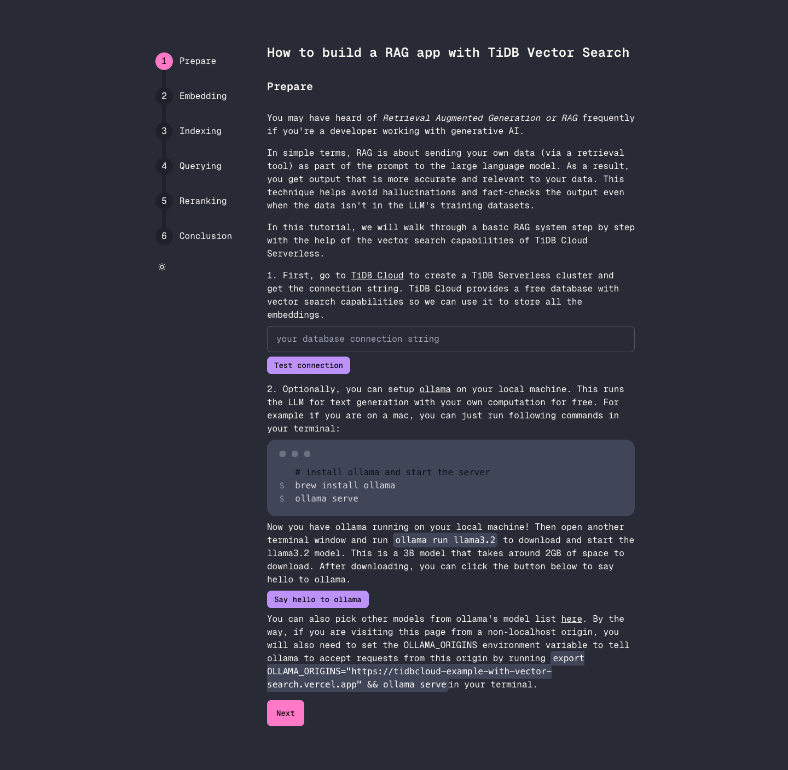

# TiDB Vector Search Example - How to build your own RAG app

An interactive demo showcasing TiDB's vector search capabilities. This demo allows you to explore and experiment with semantic search functionality powered by TiDB's vector similarity search feature.



Run this example locally with your own test database and Jina API key. It does not include user authentication or abuse controls. See the [usage boundaries](../../README.md#local-usage) before exposing it publicly.

## Features

- Interactive vector search demonstration
- Real-time semantic similarity search
- Built-in sample documents and queries
- Custom query testing capability

## How Vector Search Works

1. Document Storage:
   - Each document is converted into a high-dimensional vector (embedding)
   - Both the original content and vector embeddings are stored in TiDB
   - Vector indexes enable efficient similarity search

2. Search Process:
   - Your search query is converted to a vector
   - TiDB finds documents with similar vector representations
   - Results are ranked by similarity score

## Running Locally

### Prerequisites

1. Sign up for a [TiDB Cloud](https://tidbcloud.com/) account
2. Create a Serverless Tier cluster (free)
3. Get a [Jina AI API key](https://jina.ai/) for text embeddings

### Setup

1. Clone this repository and enter the example directory:

```bash
git clone https://github.com/tidbcloud/examples-projects.git
cd examples-projects/examples/with-vector-search
```

2. Create a `.env` file in this directory:
```env
JINA_API_KEY=your_jina_api_key
```
3. Install and run:
```bash
pnpm install
pnpm dev --hostname 127.0.0.1
```

Visit `http://localhost:3000` to see the demo locally.

4. Enter your test database connection string in the app and follow the tutorial to create the `documents` table, index sample documents, query them, and rerank results. You do not need to put the database connection string in `.env`.

5. For the optional local LLM steps, install [Ollama](https://ollama.com/download), start it with `ollama serve`, and run `ollama run llama3.2` in another terminal. Follow the in-app instructions if Ollama requires an allowed browser origin.

## Learn More

- [TiDB Vector Search Documentation](https://docs.pingcap.com/tidbcloud/vector-search-overview)
- [Integration with TiDB Vector Search](https://docs.pingcap.com/tidbcloud/vector-search-integration-overview)
